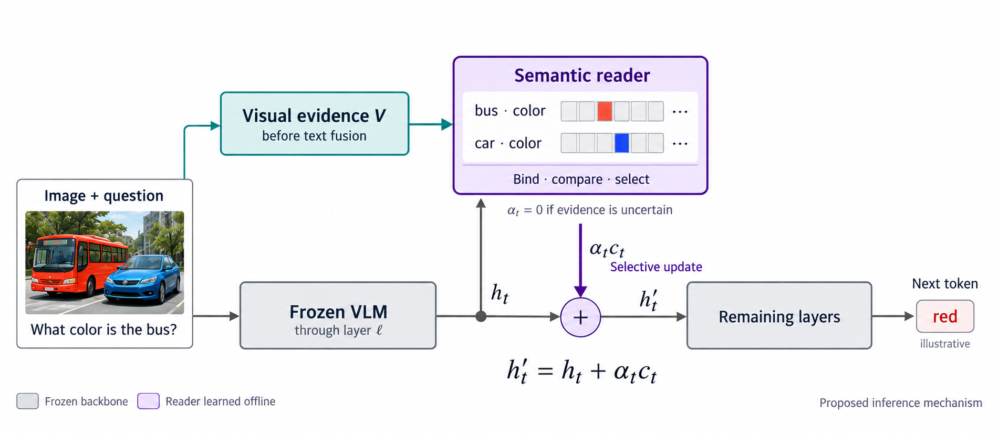

# Object-Bound Semantic Steering

[한국어 요약](README_KO.md)

**Status: research proposal, not an implemented or validated method.** This document archives the current candidate design and its English overview figure. No reader has been trained, no new inference experiment has been run, and no performance result is claimed.

The illustrated candidate keeps the VLM weights frozen and learns a small reader offline. It is **not training-free**. Whether to retain this learned reader or develop a no-additional-training alternative remains an open design decision; publishing this proposal does not settle that choice. **LatentLens is not integrated.**



The figure is an AI-generated conceptual schematic; its example answer is illustrative, not an observed result.

## Research question

Can a reader identify an editable activation component representing a fact about a particular object, then use current visual evidence to correct that fact while preserving other facts?

For an image containing a red bus and a blue car, reading “red” is insufficient: the representation should distinguish the bus's color from the car's color. The intended contribution is the connection between object-bound meaning and selective causal intervention, not merely an input-dependent steering strength.

## Minimal candidate

Start with one Qwen2.5-VL model, one decoder layer selected on development data, short color questions, and a small low-rank representation. Extend only after the mechanism is supported by experiments.

1. Read projected visual tokens before language-context fusion.
2. Obtain instance-specific visual representations and calibrated visual support.
3. Read the current decoder state before predicting the next token.
4. Select the component associated with the relevant object and attribute.
5. Apply a bounded residual update, or choose no intervention.
6. Continue through the remaining decoder layers to predict the next token.

The current question and already generated prefix select the fact of interest. They do not become evidence that an image contains that fact. Low visual support is treated as uncertainty rather than proof of absence.

## Candidate parameterization

For a decoder state `h_t ∈ R^d`, use a learned basis `U ∈ R^(d×r)` with orthonormal columns. Let `m_(k,t) ∈ [0,1]^r` select coordinates associated with object instance and attribute `k`. A learned visual-to-decoder bridge supplies `z_k^visual ∈ R^r`.

```text
z_t     = Uᵀ h_t
c_(k,t) = U [m_(k,t) ⊙ (z_k^visual − z_t)]
h′_t    = h_t + α_(k,t) c_(k,t)
```

The first implementation selects one object–attribute component at a time. Multiple components may later be combined under a shared update budget. Even with a shared basis, instance-dependent coordinate selection and target values can change the update direction.

These equations specify an **initial intervention candidate**, not proof that the coordinates are semantic or disentangled. Raw visual and decoder embeddings are not directly subtracted: the bridge must be learned and calibrated for the chosen decoder site.

The difference term proposes a direction; it does not require exact equality between visual and decoder states. Selection should favor sufficient support for the visually grounded fact over competitors, while penalizing changes to other facts and intervention magnitude. Include `α = 0` whenever evidence is uncertain, the fact is already sufficiently supported, or improvement over no intervention is not justified.

## Learning and causal validation

**Controlled fact changes.** Build scene families containing at least two distinguishable object instances. Change only the target attribute, only a non-target attribute, or nuisance factors such as background and question wording. Preserve instance identities and record visibility. Keep all variants of a scene in the same data split.

**Object-bound reading.** Train the readout against instance–attribute labels, rather than independent object and color labels. Include same-category objects, attribute swaps, paraphrases, and held-out scenes. A reader's failure to detect a fact must remain distinguishable from the fact being absent.

**Selective donor patching.** Use matched question/prefix conditions to obtain recipient and controlled-donor activations. Keep the recipient's selection mask fixed and test:

```text
h_patched = h_recipient
          + U [m_k ⊙ Uᵀ(h_donor − h_recipient)]
```

Changing the bus-color component should alter the bus-color answer toward the donor fact. Separate non-target questions should retain their original answers. Evaluate these changes in actual VLM outputs, not only the reader's own scores. Combine semantic supervision, target-change objectives, non-target preservation, and a bounded intervention budget.

**Current-image bridge.** Once selective patching works, learn to supply useful target coordinates from the current image. Do not simply regress to erroneous baseline hidden states; use validated reference states and actual intervention outcomes. Stabilizing the basis before bridge training is an initial engineering option, not an established optimum.

Freeze backbone parameters while retaining gradients through the intervened computation. The differentiable forward path, rather than generation wrapped in `no_grad()`, is required for causal training losses.

## Inference boundary

Inference may use only the current image, question, and already generated prefix. Donor images, answer labels, future generated text, and ground-truth object masks must not enter the deployed reader.

Ground-truth localization may be used for an explicitly labeled diagnostic, but final evaluation requires predicted localization or learned slots. Template questions may initially identify the requested attribute; selecting facts during unrestricted caption generation is additional work.

Cache image evidence per request and read the current decoder position at each selected generation step. Start by modifying only the final prefill position and the current decode position. Remove hooks on all exits and isolate request-local state.

An effect predictor that estimates candidate-specific semantic changes and side effects is a **possible later extension**. It is not implemented and is not necessary to claim that the initial component has been causally tested.

## Development oracle and comparisons

Distinguish controlled donor patching, which diagnoses a possible mechanism, from a deployable-candidate oracle. The latter chooses the best action using development labels from exactly the candidate set that the current image can generate. It is an upper-bound diagnostic, not a test-time selection policy.

- **Reader selection:** hold intervention candidates, data, and budgets fixed; compare the proposed reader with a reference lens, a risk-only reader, and a matched-size direct action policy.
- **Component construction:** allow component generation, but match data, capacity, and intervention magnitude; measure target correction and non-target preservation.
- **Dynamic content:** separate fixed direction with dynamic strength, dynamic direction with fixed strength, and both dynamic.
- **Grounding controls:** test target-only image edits, question/prefix changes, and unchanged-image controls to separate visual ambiguity, decoder misuse, and reader error.
- **Generation evaluation:** retain REVIS, RUDDER, GrAInS, and VTI as method baselines with implementation provenance recorded. Expand to object existence, POPE, and CHAIR; report recall, yes ratio, caption length, general capability, and latency alongside hallucination metrics.

A gain visible only in the reader's own score is insufficient. If the current-image candidate oracle cannot improve behavior, revise the intervention mechanism before adding a larger selector.

## Proposed implementation locations

The following are planned extensions, **not files or functionality delivered by this proposal**:

| Location | Proposed responsibility |
|---|---|
| `src/vlm_grounding/semantic_reader.py` | Basis, instance–attribute selection, semantic heads, visual-to-decoder bridge |
| `src/vlm_grounding/semantic_steering.py` | Request-local state, bounded updates, no-op selection, temporary hooks |
| `scripts/collect_semantic_pairs.py` | Controlled-pair activation collection and provenance |
| `scripts/train_semantic_reader.py` | Semantic and selective causal learning |
| `scripts/evaluate_semantic_oracle.py` | Current-image candidate oracle and preservation evaluation |
| `configs/qwen_semantic_reader.json` | Fixed model revision, intervention site, rank, splits, and budgets |

Extend the existing adapter with a model-specific projected-visual-token API and add a separate method entry to the CLI. Preserve visual token spatial ordering. Attention output is not automatically an image-only message; explicit message decomposition would require separate instrumentation.

Minimum engineering checks are zero-update equivalence, gradient connectivity, prefill/decode position correctness, exception-safe hook removal, and no request-state leakage. Candidate trials must start from independent copies of the same prefix/cache state.

## Open decisions and claim limits

The reader's training regime, localization method, rank, layer, supervision source, and confidence calibration remain unresolved. The current figure represents the learned-reader candidate only.

[LatentLens](https://arxiv.org/html/2602.00462v5) and [RAVEL/MDAS](https://aclanthology.org/2024.acl-long.470/) are related-work and comparison candidates, not integrated dependencies. A dedicated literature and implementation review is still needed. Neither low-rank editing nor selective patching alone establishes novelty.

This branch should be read as a documented research hypothesis with staged validation criteria, not a reproducible implementation or evidence of improved benchmark performance.

